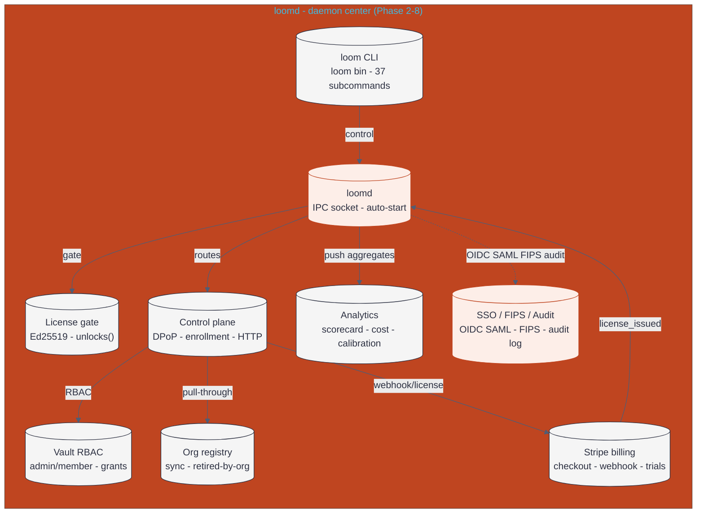

# homebrew-loom

Homebrew formula for [Loom](https://github.com/tusharmewara/loom) — the shared
ecosystem for AI coding tools.

[](https://github.com/tusharmewara/loom/releases)
[](https://github.com/tusharmewara/loom/blob/main/LICENSE)


## Architecture diagram

The [architecture diagram](./architecture.html) shows the loomd daemon at the center of the ecosystem: the CLI, control plane, license gate, vault RBAC, org registry, Stripe billing, analytics, and SSO/FIPS/audit crates all connect through it.

The diagram opens as a self-contained HTML page with inline SVG — view it directly in the browser or embed it in slides/docs.

<figure>
  
  <figcaption style="font-family:system-ui,sans-serif;font-size:0.85rem;color:#666;margin-top:0.5rem;">Loom shared agentic ecosystem — loomd daemon with analytics, SSO/FIPS/audit, billing, and license gate crates. <a href="./architecture.html">View standalone diagram</a></figcaption>
</figure>

**GitHub-native render (Mermaid):**



Copy the Mermaid source: [`architecture.mmd`](./architecture.mmd) — paste into mermaid.live for editing.

---

## The Problem

If you use multiple AI coding tools (Claude Code, jcode, Cursor, Goose, opencode,
crush...), you've probably noticed they don't share anything. Skills you install
in one are invisible to the rest. MCP servers need to be configured separately
each time. Sessions are locked inside whichever tool created them.

Loom is the **shared layer** between all of them.

## Quick Start

```bash
# Install
brew tap tusharmewara/loom
brew install loom

# Initialize the ecosystem (creates ~/.loom/)
loom init

# Optional-but-recommended: start the background daemon
brew services start loom
```

That's it. Run `loom status` to confirm everything is set up.

## First Steps

Once Loom is installed, these are the first things to try:

```bash
# See what Loom knows about — tools, skills, MCP servers
loom scan

# Check the health of your setup
loom doctor

# List installable MCP servers from the registry
loom mcp list-known

# Install one (e.g., Playwright for browser automation)
loom mcp install playwright

# List registered skills
loom skills list
```

Everything you add (MCP servers, skills, tools) becomes available to **every**
tool in your ecosystem — no per-tool configuration needed.

## Real-World Scenarios

### Share an MCP server across tools

```bash
# Install once
loom mcp install filesystem

# Use from any tool — Claude Code, jcode, Goose, etc. — all share it
# without needing separate configs
```

### Export a session and continue elsewhere

```bash
# After a session in any tool, export it to Loom's shared storage
loom sessions list
loom sessions export <session-id> --output session.jsonl

# Resume it in a different tool with full history
loom sessions resume <session-id> --provider anthropic --model claude-sonnet-4

# With knowledge injection, Loom enriches the resumed session with
# relevant context from past sessions
loom sessions resume <session-id> --inject-knowledge
```

### Route tasks to the right model automatically

```bash
# Loom scores complexity and picks the right tier
#   simple fixes → Slm (fast/cheap)
#   complex architecture → Flagship (slow/expensive)
loom routing evaluate "Write a Python script to parse this CSV"

# Override for a specific task when needed
loom routing override <task-id> --tier flagship --reason "needs deep reasoning"
```

### Dispatch a task to an agent and track it

```bash
# Run one canonical ACP prompt turn against an agent — output is
# captured as an indexed session, with per-run logs and status
loom acp run
loom acp run-status

# List launchable agents (daemon handlers + agents.toml entries)
loom acp agents
```

### Remember facts across sessions

```bash
# Retain a durable fact, then recall it in a later session
loom memory retain "the project uses a cargo workspace with 30+ crates"
loom memory recall "how is loom structured"

# Synthesize an overview from retained memory
loom memory reflect
```

## Daemon

The daemon (`loomd`) is a background service that keeps the ecosystem hot —
shared MCP connections, session indexing, event bus, knowledge graph, ACP
dispatch, and the runtime registry — so CLI commands start instantly. It
auto-shuts down after 5 minutes idle.

```bash
# Via Homebrew
brew services start loom     # Start
brew services stop loom      # Stop
brew services restart loom   # Restart

# Or let loom manage the service natively (launchd/systemd)
loom daemon install-service
```

Without the daemon, `loom` still works — it just initializes subsystems on
demand, which is slightly slower. The ACP dispatch server starts with the
daemon (manage it with `loom acp start|stop|status`); the memory server runs
separately via `loom memory start`.

## What Loom Provides

| Feature | What it does |
|---------|-------------|
| **Skills** | Write a skill once, use it from any tool. Portable YAML files, auto-loaded by all tools, lockable via `loom lock` for reproducibility. |
| **Sessions** | Export from one tool, resume in another. Full history + compression, branching, tagging, search, and merge. |
| **MCP Servers** | Register once, share across every tool. Pooled connections, health checking, and a stdio MCP server (`loom mcp serve`). |
| **Auth & Credentials** | Encrypted credential vault (ChaCha20Poly1305) with role-based ACLs and audit logging. |
| **Hooks** | Intercept tool actions (pre/post task, session events) with executable scripts. Signed for integrity. |
| **Knowledge Graph** | Entities and relationships extracted from session history. Powers search, recommendation, and context injection. |
| **Model Routing** | Automatic complexity scoring routes tasks to the right model tier (Slm / Mid / Flagship). |
| **Workflows** | Multi-phase task orchestration with phase transitions, templates, and manual overrides. |
| **ACP Dispatch** | Dispatch tasks to agent tools over the Agent Client Protocol with tracked runs, per-run logs, and session capture. |
| **Container Runtimes** | Execute work in Docker, Podman, or Kubernetes (Jobs, no kubectl) via a pluggable runtime layer. |
| **Cross-Session Memory** | Hindsight memory: retain durable facts, recall them by query, reflect over what's known. |
| **Code Intelligence** | LSP (rename, find-refs) and DAP debugging (launch, attach, breakpoints) integrated into the ecosystem. |
| **Editing & Conflicts** | Content-hash anchored edits (Hashline), tree-sitter AST editing, and merge-conflict resolution. |
| **Issue Tracking** | GitHub Issues and Linear integration: list, comment, create branches, open PRs (`loom issues create-pr`). |
| **Plugin Registry** | Install tool integrations from URLs with SHA-256 verification and optional Ed25519 signatures. |
| **Remote Execution** | Run commands over SSH and persist output as indexed sessions. |

## Command Reference

### Core
```
loom init                          Create ~/.loom/ tree
loom scan                          Display resource summary
loom status                        Show ecosystem state
loom doctor                        Deep diagnostics
loom thread <tool>                 Register/update a tool in the ecosystem
loom exec <tools...> [-- args...]  Execute tools with ecosystem
loom tui                           Launch terminal UI
loom config show|validate|fetch    Inspect merged config, validate, fetch remote config
loom init-shell                    Shell integration script (transparent loom activation)
loom sync                          Sync loom-managed resources to tool-native locations
loom completions <shell>           Generate shell completions (bash/zsh/fish/…)
loom self-update                   Check for a new version and install
loom --no-update                   Skip the automatic update check on startup
```

### MCP
```
loom mcp list|show|add|remove      Manage registered MCP servers
loom mcp install <name>            Install a known MCP server
loom mcp install-recommended       Install all recommended MCP servers
loom mcp list-known                List installable MCP servers
loom mcp serve                     Start the stdio MCP server (for MCP-compatible tools)
```

### Skills & Plugins
```
loom skills list|show|install|remove   Manage skills
loom lock --generate|--verify          Skill lock file for reproducibility
loom plugin search|install|register|update|remove|list|show   Plugin registry
loom add-acp-agent <agent-id>          Add a tool from the ACP registry
```

### Sessions & Memory
```
loom sessions list|show|export|import|resume   Portable session bundles
loom sessions search|recall|index              Cross-session full-text search / recall
loom sessions branch|tag|tags                  Fork at a checkpoint; tag sessions
loom sessions summarize|merge                  Compress history; combine sessions
loom memory status|start|stop                  AgentMemory server control
loom memory retain|recall|reflect              Durable cross-session facts
```

### Routing
```
loom routing evaluate <prompt>     Score prompt complexity + tier decision
loom routing score <prompt>        Complexity score only
loom routing recommend <task-id>   Routing recommendation for a task
loom routing override <task-id>    Override routing decision
loom routing show                  Show routing config + model catalog
loom routing catalog               Manage model catalog
```

### Knowledge
```
loom knowledge build               Build knowledge graph from sessions
loom knowledge query <entity>      Query subgraph around entity
loom knowledge search <query>      Search entities
loom knowledge stats               Graph statistics
loom knowledge add|relate|clear    Manual entities/relationships; reset graph
```

### Workflows
```
loom workflow list|show|create|remove         Task orchestration
loom workflow draft-plan [--create]           Draft a plan from free text
loom workflow advance|assign|dispatch         Phase transitions and agent dispatch
loom workflow set-sub-agents|template         Per-phase agents; reusable templates
```

### ACP Dispatch
```
loom acp status|start|stop|show    ACP dispatch server control
loom acp agents                   List launchable ACP agents
loom acp run                      Run one canonical ACP prompt turn (indexed session)
loom acp run-status               Status/exit code/session of a tracked run
```

### Runtimes (Docker / Podman / Kubernetes)
```
loom runtime list                 Available runtimes
loom runtime set-default          Set default runtime
loom runtime status               Runtime status
```

### Issues
```
loom issues list|show             List/show tracker issues (GitHub Issues)
loom issues create-branch         Create a git branch from an issue
loom issues link-pr               Link a PR URL to an issue
loom issues pull-requests|diff|ci-status   PR listing, diffs, CI status (GitHub)
loom issues create-pr             Open a pull request via gh
```

### Remote
```
loom remote list|add|remove       Manage SSH connections
loom remote exec <cmd>            Execute on a remote host (--capture-session)
loom remote sync                  Sync files to/from a remote host
```

### Auth, Hooks & Rules
```
loom auth list|providers          List credential vault entries / LLM providers
loom auth show|validate           Provider config and credential validation
loom hooks list|show|register|remove   Manage hook scripts
loom hooks run <event>            Run hooks for an event (parallel)
loom hooks verify                 Verify hook signatures
loom rules list|show|add|remove   Event stream rules
loom rules eval                   Evaluate a synthetic event against rules
```

### Code Intelligence & Editing
```
loom lsp servers|rename|find-references|exec   LSP operations via registered adapters
loom debug adapters|launch|attach              DAP: discover adapters, start sessions
loom debug breakpoints|step|evaluate|stack|continue   Debug session control
loom edit hash|apply|validate      Content-hash anchored editing (Hashline)
loom ast parse|query|…|format       AST structural editing (tree-sitter, 16 subcommands)
loom conflict scan|resolve|resolve-bulk|show   Merge conflict detection/resolution
```

### Telemetry
```
loom telemetry show|reset          Metrics snapshot and counters
```

### Daemon
```
loom daemon start|stop|restart     Control loomd
loom daemon status                 Show daemon status
loom daemon install-service        Install as launchd/systemd user service
loom daemon uninstall-service      Remove the user service
```

## Formula

| File | Purpose |
|------|---------|
| `Formula/loom.rb` | Homebrew formula with bottles for `arm64_sonoma`, `arm64_tahoe`, `tahoe` |
| `scripts/update_formula_checksums.sh` | Fetch bottle checksums from GitHub Releases and rewrite the formula |
| `.github/workflows/update_checksums.yml` | CI: on release (or manual dispatch), updates formula checksums |

## Filesystem

```
~/.loom/
├── config.toml          # Main config
├── config/              # Layer overlays (routing, mcp, hooks, acp, agents)
├── skills/              # Shared skills database (+ skills.lock)
├── mcp/                 # MCP server configs
├── sessions/            # Session exports
├── auth/                # Encrypted vault + audit logs
├── hooks/               # Hook TOML configs and scripts
├── knowledge/           # Knowledge graph (SQLite + FTS5)
├── plugins/             # Installed plugin manifests
├── workflow/            # Workflow tasks, templates, sidecars
├── runs/                # Tracked ACP dispatch runs (logs + status)
├── worktrees/           # Per-task git worktrees
├── tools/               # Tool registration files
├── loomd.sock           # Daemon IPC socket
└── mcp_registry.db      # MCP registry (SQLite)
```

## Latest Release — v0.12.0

### Features added

| Area | What's new |
|------|-----------|
| **Analytics** | `loom org analytics` / `scorecard` / `cost` / `calibration` — org-level rollups, per-tool breakdowns, cost-only views, and measured-vs-estimated calibration ratios. Push-only model: hosts push aggregated buckets; the control plane never stores per-run data (structural privacy invariant). |
| **SSO Federation** | OIDC (OAuth 2.1 + PKCE) and SAML 2.0 support for Entra ID, Okta, Google Workspace, ADFS. `loom org connect --sso` initiates device-code or browser flows. JIT human provisioning with seat cap enforcement. |
| **On-prem hardening** | FIPS mode via `ring` (`LOOM_FIPS=1`), air-gap mode (`LOOM_AIR_GAP=1` blocks all outbound calls), AES-256-GCM config encryption for secrets at rest (`loom-cp config encrypt/decrypt`). |
| **Audit logging** | Structured audit log in SQLite (`{loom_dir}/control-plane/audit.db`) — actor, action, resource, outcome, timestamp. Query via `GET /api/v1/org/{org_id}/audit`. |
| **Readiness probe** | `/health/ready` endpoint reports DB, Stripe, FIPS, and air-gap status. |
| **Control plane endpoints** | `POST /api/v1/org/{org_id}/analytics/push`, `GET /api/v1/org/{org_id}/analytics`, `GET/PUT /api/v1/org/{org_id}/sso`, SAML metadata/ACS, OIDC authorize/callback. |

### Usage examples

```bash
# Install v0.12.0
brew tap tusharmewara/loom
brew install loom

# Initialize and start the daemon
loom init
brew services start loom

# Connect to a control plane with SSO
loom org connect --sso http://cp.example.com:7333 --org acme

# Push analytics from a host
# (host-side: aggregate local usage ledger into per-org/tool/day buckets)
# then view on any machine:
loom org analytics --org acme --format table
loom org scorecard --org acme --format json
loom org cost --org acme --format table
loom org calibration --org acme

# Check control plane health
curl http://cp.example.com:7333/health/ready
```

### Use cases

- **Enterprise SSO**: Let your org's humans sign in with their existing IdP (Entra ID, Okta, Google, ADFS) instead of managing separate Loom credentials. First SSO login creates the human in the roster (JIT provisioning), subject to seat cap.
- **Team cost visibility**: Push per-tool aggregated usage from each host, then view org-wide scorecards to see which tools are driving cost and how accurate the `chars/4` cost estimator is (calibration view).
- **On-prem deployments**: Run `loom-cp` with `LOOM_FIPS=1` for FIPS-compliant crypto and `LOOM_AIR_GAP=1` in air-gapped environments where no outbound network is allowed. Encrypt Stripe keys and SAML certs at rest.
- **Compliance auditing**: Query the audit log to see which admin performed which action, when, and with what outcome — all stored locally in SQLite.
- **Multi-tool ecosystems**: Install Loom once and every agent tool (Claude Code, jcode, Cursor, Goose, crush, opencode, gemini-cli, kiro, juno, github-copilot) shares skills, MCP servers, sessions, credentials, and workflows without per-tool config.

## License

MIT
